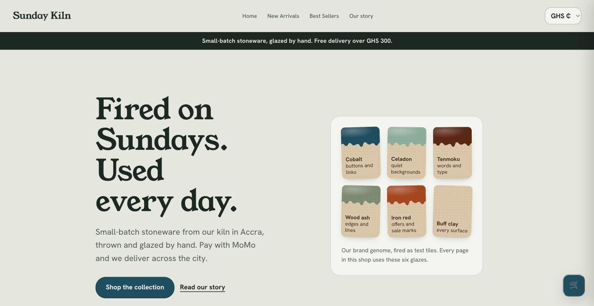
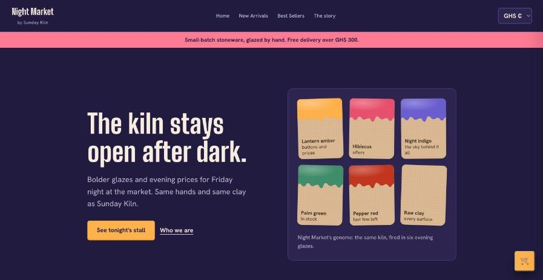
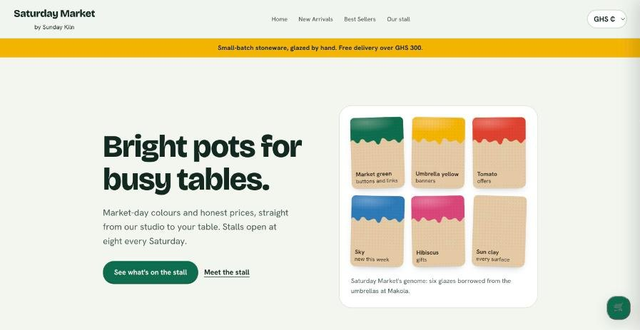

# Brand Genome

**One kiln, three brands, fired from one recipe.** Entry for the Krifth Developer Hackathon 2026.

Sunday Kiln is a small pottery studio in Accra. Brand Genome lets one maker run several storefront brands from one catalogue, one mobile money method and one pair of AI agents. Each brand is a *genome*: a short recipe of design tokens (six glazes, a typeface, a corner shape, a voice) that every page, price and checkout step reads from.

Potters record a glaze recipe by firing test tiles. So each storefront shows its own genome as a board of glaze test tiles, and every product is drawn as a pot dipped in one of those glazes. The system that normally hides in the code is the first thing a shopper sees.

- **Live preview:** https://mukeshkbj.github.io/brand-genome/ (static copy of the three themes; checkout runs on Krifth)
- **Judges' overview:** https://claude.ai/artifact/78FMKip8otLY5s6RrrP5Pm



| Night Market | Saturday Market |
|---|---|
|  |  |

## What's in the entry

| Part | What it does |
|---|---|
| 3 themes | Sunday Kiln (celadon ash, cobalt, Young Serif), Night Market (night indigo, lantern amber, Big Shoulders Display), Saturday Market (Makola umbrella colours, Bricolage Grotesque). Same templates, only the genome changes. All text pairs pass WCAG AA. |
| Glaze test tiles | The home page draws the genome as six tiles, each labelled with the part of the shop it colours. |
| Pot drawings | Each product is drawn as its vessel (mug, bowl, vase, plate or candle jar, picked from its name), dipped in a brand glaze. Also replaces broken photos. |
| Weather-aware shelf | On the live store, today's Accra forecast (Open-Meteo, no key, nothing sent about the shopper) moves mugs and bowls first when rain is due, and says why in the banner. |
| Mobile money | Paystack MTN MoMo / Telecel Cash payment method, settling in GHS; tested end to end. |
| Two currencies | GHS / GBP switch. Each unit price is converted once, then lines are multiplied and summed in pence, so totals always add up; checkout states the exact GHS charge. |
| Accessible checkout | Labelled fields with autocomplete, dialogs with focus trap and Escape, live regions for errors and payment status, 44px targets. |
| Agents | Kiln Keeper (stock, orders, coupons in two brand voices) and Promo Planner (weather, holidays, phone alerts). Both confirm before acting. 7 tasks run and submitted. |

## Repo layout

```
krifth-theme/
  genome-layer.css          the shared design layer added to each theme's layout.html
  genomes/*.css             the three genome blocks (:root tokens) and their font links
  sections/hero-*.html      the glaze-tile hero for each brand
  sections/living-genome.html  weather-aware shelf script for the header
  snippets/                 Jinja for choosing the pot shape and drawing it
docs/preview/               static preview of the three brands (GitHub Pages)
tools/                      the four agent tools and what we learned
starter/                    the original Node prototype (genome editor, mock MoMo, 13 tests)
```

## Install in a Krifth theme

1. In `layout.html`, replace the `:root { ... }` block with one file from `genomes/`, add its font links in `<head>`, and paste `genome-layer.css` before the last `</style>`.
2. Replace `sections/hero.html` with the matching `hero-*.html`.
3. In the Homepage and Collection templates, put `snippets/vessel-class.jinja` before each card and use `snippets/pot-art.html` for the product image.
4. Add `sections/living-genome.html` to the header.

The cart, checkout and payment code are the Krifth starter, unchanged apart from the accessibility and currency layers.

## Run the starter

```bash
cd starter
npm start      # http://localhost:3000
npm test
```

MIT licence.
